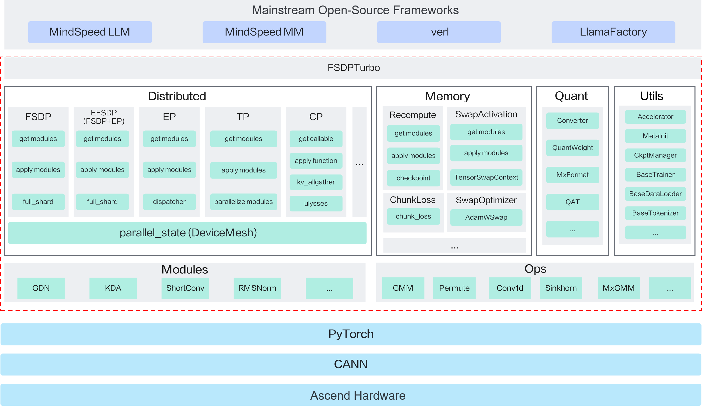

# Introduction

## Overview

FSDPTurbo is a distributed training acceleration library that combines high performance with ease of use. Built on a design philosophy of high cohesion and low coupling, it delivers a general-purpose acceleration solution decoupled from the model architecture for training large-scale deep learning models.

FSDPTurbo is built on PyTorch FSDP2 (DTensor fully sharded data parallelism) and directly connects to the Hugging Face Transformers ecosystem: after loading a model with the native `AutoModel`, users can complete the parallelization simply by calling `FSDPTurbo(config, model)`, significantly reducing the integration cost of distributed training for large models.

FSDPTurbo targets Ascend NPUs and optimizes large-model training from three aspects: parallelism optimization, memory optimization, and quantization acceleration.

## FSDPTurbo Architecture

The architecture of FSDPTurbo is shown in [Figure 1](#architecture). It adopts a layered architecture overall: user configuration is orchestrated through the `FSDPTurbo(config, model)` entry point, which connects to three capability domains below — distributed parallelism, memory optimization, and quantization acceleration — built on a foundation of Hugging Face models and multi-backend operators.

Responsibilities of each module:

- **Distributed Parallelism (`Distributed`)**
    - **FSDP**: implemented based on the PyTorch FSDP2 API; supports mixed-precision training, forward/backward prefetch, selective module sharding, and provides a `custom` implementation path.
    - **EFSDP**: fully shards the expert parameters after EP sharding; configured via `apply_efsdp_modules`.
    - **EP**: designed for MoE models; supports multiple dispatchers (`eager`, `fused`, `mc2`, `domino`) and custom EP forward.
    - **TP**: supports column parallelism, row parallelism, and sequence parallelism, integrated with DTensor.
    - **CP**: Ulysses style; supports long-sequence training.
    - **parallel_state**: global parallelism state management that uniformly manages the multi-dimensional parallel device mesh (DeviceMesh).
- **Memory Optimization (`Memory`)**
    - **Recompute**: gradient checkpointing that reduces activation memory usage.
    - **ChunkLoss**: chunk loss computation, suitable for large-vocabulary models.
    - **SwapActivation**: asynchronously offloads activations to CPU memory.
    - **SwapOptimizer**: offloads optimizer states to CPU to reduce memory usage.
- **Quantization Acceleration (`Quant`)**
    - **Converter**: model conversion framework that makes it easy to deploy quantization in models.
    - **QuantWeight**: block-wise quantization with configurable block size for fine-grained control.
    - **MxFormat**: defines the MXFP8 quantization formats (E4M3, E5M2, HIF8, E2M1) and their configuration.
    - **QAT**: currently provides the W8A16 scheme, covering Linear and GMM.
- **General Utilities and Training Support (`Utils`)**
    - **Accelerator**: accelerator adaptation layer that unifies NPU device access (delegated to `torch.accelerator`) and automatically returns the corresponding communication backend (HCCL).
    - **MetaInit**: module weight initialization that runs `_init_weights` or generic random initialization on submodules.
    - **CkptManager**: checkpoint manager (`Checkpointer`) responsible for saving/restoring weights and optimizer states.
    - **BaseTrainer**: base trainer that encapsulates the training loop logic.
    - **BaseDataLoader**: data loading; builds DataLoaders for text/multimodal datasets.
    - **BaseTokenizer**: tokenizer factory supporting Hugging Face loading and custom registration.
- **Custom Modules (`Modules`)**
    - **GDN**: GatedDeltaNet linear attention module.
    - **KDA**: Kimi Delta Attention (KDA) module, with Ulysses context parallelism support.
    - **ShortConv**: short convolution module.
    - **RMSNorm**: normalization module.
- **Backend Operators (`Ops`)**
    - Organized by device backend (`npu/`, `cpu/`, `triton/`) and automatically dispatched through a unified registration mechanism (`registry.py`).
    - **GMM**: grouped matrix multiplication, the core operator for MoE expert computation.
    - **Permute**: token/expert permutation, supporting MoE dispatch/combine.
    - **Conv1d**: causal 1D convolution, supporting the short convolution module.
    - **Sinkhorn**: HC-Split Sinkhorn algorithm for MoE routing normalization.
    - **MxGMM**: MXFP8 low-precision grouped matrix multiplication for the quantized MoE path.

**Figure 1**  FSDPTurbo architecture

## Features

- **Multi-dimensional parallelism strategies**: supports free combination of FSDP/TP/EP/EFSDP/CP multi-dimensional parallelism (DP × FSDP × TP × EP × CP), selects modules based on wildcard patterns (such as `*.q_proj`, `model.layers.{*}`), and is decoupled from specific model structures.
- **Native Transformers compatibility**: enables non-invasive replacement of model forward via the `module_patches` mechanism.
- **Memory optimization**: provides activation recomputation (Recompute), chunk loss (ChunkLoss), activation swapping (SwapActivation), and optimizer state swapping (SwapOptimizer), supporting large-model training with low memory usage.
- **Quantization training**: supports MXFP8 (E4M3/E5M2/HIF8) quantization formats and block-wise quantization (QuantWeight), and provides quantization-aware training (QAT), compatible with grouped GEMM on the expert parallelism path.
- **Out-of-the-box examples**: provides training example scripts and configurations for mainstream models such as Qwen3.5/Qwen3-MoE/DeepSeek V4/Kimi K3, ready to use out of the box.
