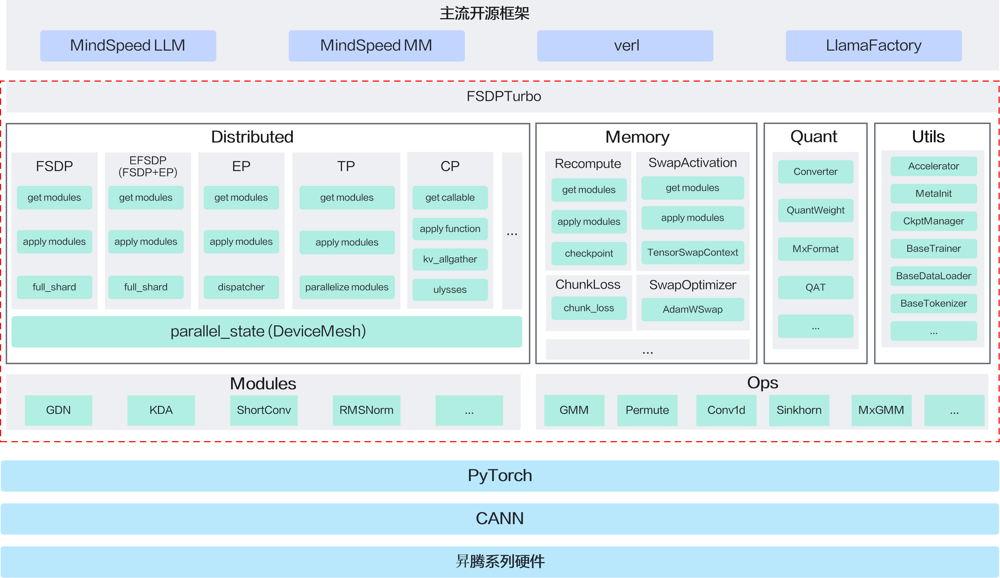

# 简介

## 概述

FSDPTurbo是一个兼具高性能与易用性的分布式训练加速库，基于高内聚低耦合的架构设计理念，打造一套与模型结构解耦的通用加速方案，用于训练大规模深度学习模型。

FSDPTurbo基于PyTorch FSDP2（DTensor全分片数据并行）构建，直接对接HuggingFace Transformers生态：用户使用原生`AutoModel`加载模型后，通过`FSDPTurbo(config, model)`即可完成并行化改造，显著降低大模型分布式训练的接入成本。

FSDPTurbo面向昇腾NPU，从并行优化、内存优化、量化加速三个方面对大模型训练进行优化。

## FSDPTurbo架构

FSDPTurbo架构关系如[图1](#架构图)所示，整体采用分层架构：用户配置经`FSDPTurbo(config, model)`入口编排，下接分布式并行、内存优化、量化加速三大能力域，底座为HuggingFace模型与多后端算子。

各模块职责：

- **分布式并行（`Distributed`）**
    - **FSDP**：基于PyTorch FSDP2 API实现，支持混合精度训练、前向/反向预取、选择性模块分片，并提供`custom`自定义实现路径。
    - **EFSDP**：对EP切分后的专家参数进一步全分片，通过`apply_efsdp_modules`配置。
    - **EP**：面向MoE模型，支持多种dispatcher（`all2all`、`allgather`、`chunkmoe`、`mc2`、`domino`，融合算子由 `use_fused_ops` 控制）以及自定义EP forward。
    - **TP**：支持列并行、行并行与序列并行，集成DTensor。
    - **CP**：Ulysses风格，支持长序列训练。
    - **parallel_state**：全局并行状态管理，统一管理多维并行设备网格（DeviceMesh）。
- **内存优化（`Memory`）**
    - **Recompute**：梯度检查点，降低激活内存占用。
    - **ChunkLoss**：损失计算分块处理，适用于大词表模型。
    - **SwapActivation**：异步将激活值卸载到CPU内存。
    - **SwapOptimizer**：将优化器状态卸载到CPU，减少显存占用。
- **量化加速（`Quant`）**
    - **Converter**：模型转换框架，轻松在模型中部署量化。
    - **QuantWeight**：分块量化，可配置块大小，实现细粒度控制。
    - **MxFormat**：定义MXFP8量化格式（E4M3、E5M2、HIF8、E2M1）及配置。
    - **QAT**：当前提供W8A16方案，覆盖Linear与GMM。
- **通用工具与训练辅助（`Utils`）**
    - **Accelerator**：加速器适配层，统一NPU设备访问（`torch.accelerator`委托），自动返回对应通信后端（HCCL）。
    - **MetaInit**：模块权重初始化，对子模块执行`_init_weights`或通用随机初始化。
    - **CkptManager**：断点管理器（`Checkpointer`），负责权重与优化器状态的保存/恢复。
    - **BaseTrainer**：训练器基类，封装训练循环逻辑。
    - **BaseDataLoader**：数据加载，构建文本/多模态数据集的DataLoader。
    - **BaseTokenizer**：分词器构建工厂，支持HuggingFace加载与自定义注册。
- **自定义模块（`Modules`）**
    - **GDN**：GatedDeltaNet线性注意力模块。
    - **KDA**：Kimi Delta Attention（KDA）模块，含Ulysses上下文并行支持。
    - **ShortConv**：短卷积模块。
    - **RMSNorm**：归一化模块。
- **后端算子（`Ops`）**
    - 按设备后端组织（`npu/`、`cpu/`、`triton/`），基于统一注册机制（`registry.py`）自动分发。
    - **GMM**：分组矩阵乘，MoE专家计算核心算子。
    - **Permute**：token/专家重排，MoE dispatch/combine配套。
    - **Conv1d**：因果一维卷积，短卷积模块配套。
    - **Sinkhorn**：HC-Split Sinkhorn算法，MoE路由归一化。
    - **MxGMM**：MXFP8低精度分组矩阵乘，量化MoE路径。

**图 1**  FSDPTurbo架构图

## 功能特性

- **多维并行策略**：支持FSDP/TP/EP/EFSDP/CP多维并行自由组合（DP × FSDP × TP × EP × CP），基于通配符模式（如`*.q_proj`、`model.layers.{*}`）选择模块，与具体模型结构解耦。
- **原生Transformers兼容**：通过`module_patches`机制可对模型forward进行无侵入替换。
- **内存优化**：提供激活重计算（Recompute）、分块损失（ChunkLoss）、激活值交换（SwapActivation）、优化器状态交换（SwapOptimizer）等手段，支持低显存大模型训练。
- **量化训练**：支持MXFP8（E4M3/E5M2/HIF8）量化格式与分块量化（QuantWeight），并提供量化感知训练（QAT），兼容专家并行路径下的分组GEMM。
- **开箱即用示例**：提供Qwen3.5/Qwen3-MoE/DeepSeek V4/Kimi K3等主流模型的训练示例脚本与配置，开箱即用。
